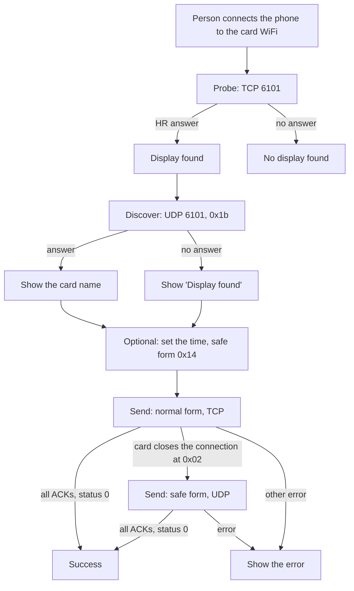
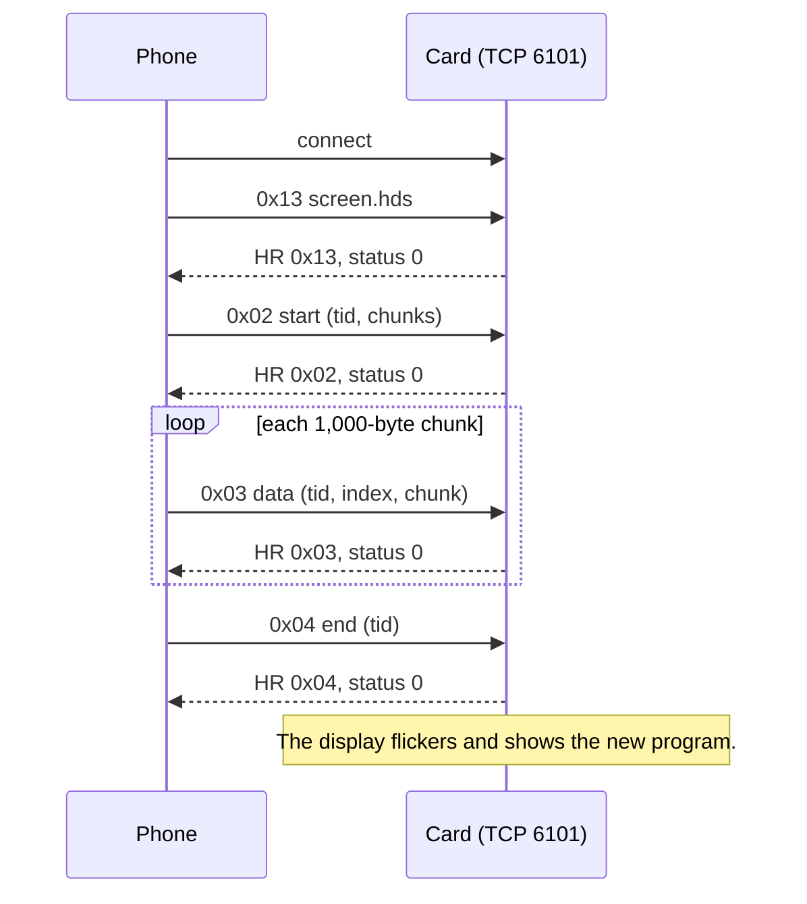
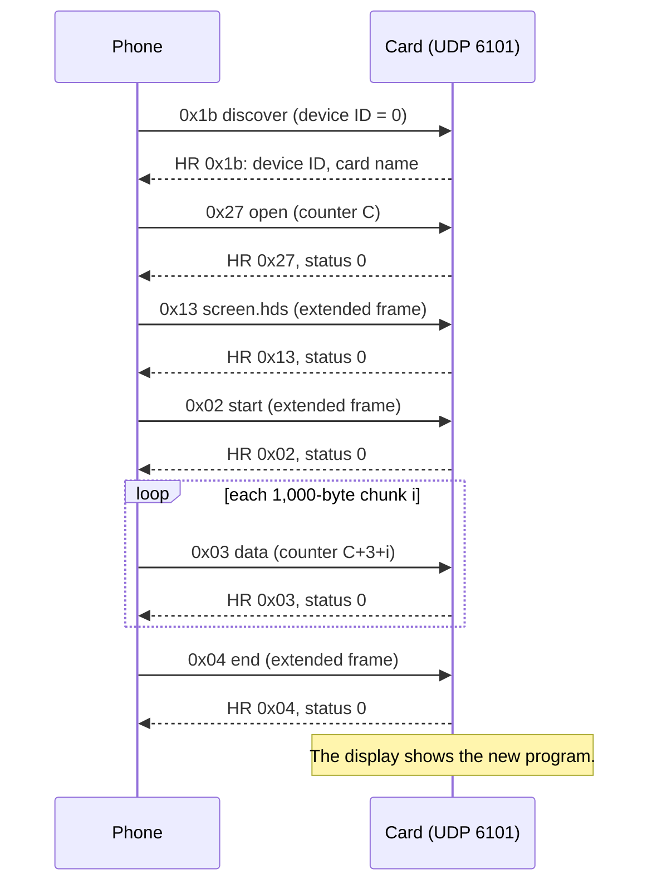
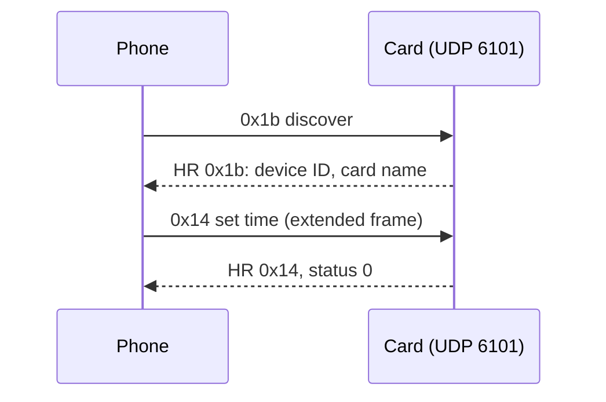

# The WF card protocol

This document describes how HD Sender sends a program and the time to a Huidu WF card
(WF1, WF2, WF4). It also describes the files that the app uses.

Huidu does not publish this protocol. The data comes from these sources:

- The Go library [alparslanahmed/huidu-led](https://github.com/alparslanahmed/huidu-led) (`hd2020_gen6.go`).
- Wireshark captures of HD2020 on 2026-10-18.
- The HD2020 program code (`CHDPack::GetSafeOnePack`).
- Tests on real cards on 2026-10-18 and 2026-10-19.

The code is in `app/protocol/src/main/kotlin/com/masjidclock/wfsender/protocol/`.

## 1. Overview

The card makes its own WiFi hotspot. The card address is `192.168.4.1`. The card listens on
port `6101` for TCP and for UDP.

The card firmware has 2 protocol forms:

| Form | Transport | Firmware | Used for |
|---|---|---|---|
| Normal form | TCP 6101 | Older firmware | Program send, probe |
| Safe form | UDP 6101 | HD_W0X_3 V4.45 | Program send, time sync, card name |

The firmware version decides the form, not the card type. The app does not know the firmware
version before it sends. Thus the app tries the normal form first. If the card refuses it,
the app uses the safe form.



All multi-byte numbers are big-endian, except for the transfer ID. The transfer ID is little-endian.

## 2. The files

### 2.1 The HD2020 U-disk export

The HD2020 "U-disk" export writes these files to the root of a USB drive:

| File | Content | Sent by the app |
|---|---|---|
| `screen.hds` | 66 bytes. Starts with `HS`. Width at bytes 4–5, height at bytes 6–7. | Yes |
| `progam.hds` | Starts with `HC`. An `HC` header, an `HP` program block, and `HA` area blocks with bitmaps. | Yes |
| `font.hds` | Glyph bitmaps. | No |
| `set.hds` | Card settings. | **No. Never send this file.** |
| `smart.ss` | Panel hardware settings. | **No. Never send this file.** |

The name `progam.hds` (not `program.hds`) is the name that HD2020 uses.

### 2.2 The `.hdpkg` package

An `.hdpkg` file is a ZIP file. It contains `screen.hds` and `progam.hds` for exactly 1 display.
The Create tab of the app makes this file from a USB drive. The Send tab reads it.

## 3. Frame format

### 3.1 Request frame, 27-byte header (`HT`)

The app sends this frame. The normal form and the safe form both use it.

| Bytes | Normal form | Safe form |
|---|---|---|
| 0–1 | `H` `T` | `H` `T` |
| 2 | `0x00` | `0x00` |
| 3 | `0x1B` (header length 27) | `0x1B` |
| 4–5 | Total frame length | Total frame length |
| 6 | Command | Command |
| 7 | `0x00` | `0x00` |
| 8–22 | `0x00` | Device ID (15 bytes) |
| 23–25 | `0x00` | Counter (bytes 23–26, 32 bits) |
| 26 | Sequence number (low 8 bits) | Counter, low byte |
| 27 … n−4 | Payload | Payload |
| n−3, n−2 | Checksum | Checksum |
| n−1 | `0xAA` | `0xAA` |

The checksum is the sum of all bytes before it, low 16 bits.

### 3.2 Extended frame, 31-byte header (safe form only)

The safe form uses this frame for the commands `0x13`, `0x02`, `0x04`, and `0x14`.

| Bytes | Value |
|---|---|
| 0–2 | `H` `T` `0x00` |
| 3 | `0x1F` (header length 31) |
| 4–5 | Total frame length |
| 6 | Command |
| 8–22 | Device ID (15 bytes) |
| 23–26 | Number (32 bits) |
| 27–28 | 31 + payload length |
| 29–30 | Tail length |
| 31 … | Payload |
| … | Tail |
| n−3, n−2 | Checksum |
| n−1 | `0xAA` |

The tail has 3 parts:

1. A fixed 17-byte block: `00 11 00 01 00 00 00 00 11 00 41 00 11 FF FF FF FF`.
2. The text `YYYY/MM/DD HH:MM:SS,,hd2020,cc573c27-8714-4be6-b987-bc66cd856ca9` (ASCII).
   The time is the phone wall-clock time. The UUID is the HD2020 installation ID from the captures.
3. A zero byte.

### 3.3 Answer frame (`HR`)

The card answers each request with an `HR` frame.

| Bytes | Value |
|---|---|
| 0–1 | `H` `R` |
| 20 | The command that the card answers |
| 21 | Status. `0x00` = success. |

A normal ACK has 31 bytes. The answer to the discover request is longer (see section 5.1).

## 4. Normal form (TCP)

### 4.1 Probe

The probe tells the app that a card is on the WiFi network. The app opens a TCP connection to
`192.168.4.1:6101` and sends the SDK version packet:

```
08 00 01 20 05 00 00 01
```

A WF card answers with an `HR` frame. The probe does not change the card.

> **CAUTION:** Do not probe a card again and again. After a card has received a program, each
> probe makes the display flicker. The app probes only until the card answers. The app does not
> probe after a send.

### 4.2 Program transfer

Before the transfer, the app writes the number of chunks into bytes 9–10 of `progam.hds`.
HD2020 does the same. The file on disk has 0 there.

- `chunks` = `progam.hds` in 1,000-byte parts. The last part can be shorter.
- `tid` = a random 16-bit transfer ID, little-endian.

| Order | Command | Sequence | Payload |
|---|---|---|---|
| 1 | `0x13` screen | 1 | The full `screen.hds` |
| 2 | `0x02` start | 2 | `05`, `tid`, number of chunks (2 bytes) |
| 3 … | `0x03` data | 3 + i | `05`, `tid`, chunk index i (2 bytes), chunk i |
| last | `0x04` end | 3 + number of chunks | `03`, `tid` |

The app sends 1 frame. Then it waits for the ACK of that command. Then it sends the next frame.
If an ACK for a different command has status 0, the app ignores it and continues to wait.



If the network fails, the app tries again, up to 3 attempts. Each attempt uses a new transfer ID.

### 4.3 How the app finds a V4.45 card

A card with firmware V4.45 accepts the `0x13` frame. Then it closes the TCP connection at the
`0x02` start frame. A retry gives the same result. When this occurs, the app stops the normal
form at once and uses the safe form (section 5).

## 5. Safe form (UDP)

The safe form is the form that HD2020 uses for firmware V4.45. The app sends each packet by
UDP to `192.168.4.1:6101` and waits for the `HR` answer. If no answer comes in 2 seconds, the
app sends the packet again, up to 3 times.

HD2020 sends broadcast packets. The card also answers unicast packets, so the app uses unicast.

### 5.1 Discover (`0x1b`)

The app must know the 15-byte device ID of the card before it sends other safe-form packets.
The discover request gives the device ID.

- Request: a 27-byte frame, command `0x1b`, device ID all zero, counter 1.
  Payload: `00 0a ff 2f ff 89 ff 06 00 0e`.
- Answer: an `HR` frame of 132 bytes or more, command `0x1b` at byte 20.
  - Bytes 3–17: the device ID.
  - Bytes 92–131: the card name, UTF-16LE, ended by a zero character. Example: `WF1_3030f98d38da`.

The app shows the card name when the display is found.

### 5.2 Program transfer

- `C` = a random 32-bit start counter.
- `chunks` and `tid` are as in section 4.2.
- The app sends `progam.hds` **without change**. It does not write the chunk count into bytes 9–10.

| Order | Command | Frame | Number field | Payload |
|---|---|---|---|---|
| 1 | `0x1b` discover | 27 | 1 | See section 5.1 |
| 2 | `0x27` open | 27 | C | `08 00 00 01 00 00 00 04 00` |
| 3 | `0x13` screen | 31 | 1 | The full `screen.hds` |
| 4 | `0x02` start | 31 | 2 | `05`, `tid`, number of chunks |
| 5 … | `0x03` data | 27 | C + 3 + i | `05`, `tid`, chunk index i, chunk i |
| last | `0x04` end | 31 | 3 | `03`, `tid` |



HD2020 also adds its project data (a ZIP file with `readback.json`) to the program, and fills
a table in the `HC` header. The card does not need this. A test on a V4.45 card on 2026-10-19
showed the program with `progam.hds` without change.

### 5.3 Time sync (`0x14`)

The app sets the card clock with 1 extended frame after the discover request.

- Command `0x14`, number field 1.
- Payload, 22 bytes:

| Bytes | Value |
|---|---|
| 0 | `0x16` |
| 1–4 | Wall-clock seconds (32 bits) |
| 5 | `0x01` |
| 6–19 | `0x00` |
| 20–21 | `54 60` |

"Wall-clock seconds" is the local time of the phone, written as seconds since
1970-01-01 00:00:00 without a time zone. For example, 12:34:00 local time on the phone gives
12:34:00 on the card, in all time zones.



The time sync was confirmed on a WF2 card with a laptop script that sends the same bytes.

## 6. Errors

| Event | Form | What the app does |
|---|---|---|
| No TCP connection or no ACK in time | Normal | Tries again, up to 3 attempts. Then shows "The WiFi signal is too weak". |
| The phone leaves the card WiFi | Normal | Stops. Shows "The phone left the WiFi of the display". |
| The card closes the connection at `0x02` | Normal | Uses the safe form. |
| No answer after 3 tries | Safe | Stops. Shows "The WiFi signal is too weak". |
| An ACK with a status that is not 0 | Both | Stops. Shows the status code. |
| A reply that is not an `HR` frame | Both | Stops. Shows "unexpected reply". |

## 7. Test status

| Card | Firmware | Program send | Time sync |
|---|---|---|---|
| WF1, 128 × 64 | Older | Normal form, confirmed | Not tested from the app |
| WF1, 384 × 32 (hijri) | V4.45 | Safe form, confirmed | Not tested from the app |
| WF2 | V4.45 | Not tested | Confirmed (laptop script) |
| WF4 | Unknown | Not tested | Not tested |
